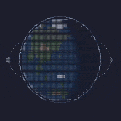

<a href="https://www.buymeacoffee.com/jasonfen"></a>

# Terminal Space Program

A Kerbal Space Program for your terminal: a real orbital-mechanics rocket
simulator drawn in braille-canvas graphics, played from the keyboard, and
shipped as a single static Go binary.



I love Kerbal Space Program and I love TUI applications, so I married the two
for whenever I'm bored and have a terminal available.

Plan transfers between planets and moons, fly your rocket off the pad and into
orbit by hand, rendezvous and dock, stage away spent boosters, and bring a
capsule home under parachute.

Under the hood it's a real sim of gravity, fuel, atmospheric drag and timing.
The default game is our own solar system at full scale. Reaching low Earth
orbit takes about 9.4 km/s, the Moon's orbit is inclined, the Earth is tilted
on its axis, and the Sol launch vehicles are real rockets (Saturn V, SLS,
Falcon 9) with accurate thrust and fuel loadouts.

## Features

- Patched-conic physics: symplectic integration in free flight, RK4 under
  thrust with rocket-equation mass loss, sphere-of-influence handoffs, drag,
  and surface contact.
- Five star systems. Sol is at full scale. Lumen is a 1/10-scale system
  modelled on KSP's (the home planet Kern with its moons Cursor and Glyph, and
  the red planet Rust) and has its own scaled fleet. Alpha Centauri,
  Kepler-452 and TRAPPIST-1 are the other three. `Tab` switches the view
  between systems; a vessel stays in the system it spawned in.
- A launch catalog that includes the Apollo stack on a Saturn V, SLS with
  Orion, Falcon 9 with a Dragon, a Cargo Dragon or 24 Starlink satellites, plus
  tugs, relays, landers and probes.
- Hand-flown launches from named sites (KSC, Baikonur and others) in a
  chase-cam launch view. On the pad with a target set, `G` warps you to the
  launch window.
- Maneuver planning: plant and edit burn nodes, plan a Hohmann transfer with
  inclination change in one key (`H`), use the Lambert and porkchop solvers
  for trips to other planets, and watch a live preview of the orbit a burn
  will leave you in.
- SOI pass preview. When your path enters a body's sphere of influence, the
  map draws the pass (entry, perilune, exit) and an SOI PASS readout. `j`
  steps a highlight through everything the map drew and names it; focusing
  the body with `f` fits the camera to the pass.
- Rendezvous and docking. `K` plans a rendezvous with a target vessel, and
  opens the Rendezvous Planner when you are too far apart in phase for one
  nudge. The Proximity view (`o`) shows both hulls at true scale for the last
  kilometres, with a Centerline scope for lining up the ports, and you fly
  the dock port to port.
- Staging you manage yourself, boosters that light with their core,
  deployable payloads (a whole Starlink batch releases at once), and a CommNet
  link model.
- A Vehicle Assembly Building (`Esc → Build (VAB)`) that builds stages from
  engines, tanks, command cores, antennas and structure, with a live
  Δv / TWR / mass readout. You can crack open a shipped rocket to tweak it and
  set a Σ Δv target, and your designs appear in the spawn form next to the
  built-in fleet.
- Flight School and a Challenge ladder of missions (`M`).
- A Flight Recording for every vessel: a text file of what it did, a row at a
  time, that you can paste into a bug report.
- Multiplayer over ssh. Host from your own game; guests join from any
  terminal, each with their own persistent program and independent time.
- Named saves, `F5`/`F9` quicksave and three rotating autosaves, all flat
  files under `~/.local/state/terminal-space-program/saves/`.
- Star systems, vessels, parts and missions are JSON. Drop files in
  `~/.config/terminal-space-program/` to add or override any of them.

## Quick start

You spawn as Apollo TLI-1, an Apollo S-IVB with the Lunar Module and the CSM
still on top, in a 500 km circular Earth orbit tilted 51.6° to the equator, so
a launch from the KSC pad can reach it. Press `t` to target the Moon (`T`
clears it), then `H` to plant a transfer, or fly it all by hand. `F1` shows
every key in-game. The [controls & flight guide](docs/controls.md) has a tour,
a launch walkthrough, and the full key list.

The game is designed for a 140×40 terminal. It runs down to 104×24 and shows a
"terminal too small" screen below that. Between the two sizes, HUD chips
shrink to a compact form and, at worst, collapse behind a `▸ +N hidden`
marker so they never overlap.

Flight School is on by default: a five-rung ladder that starts with the camera
and the planner, then walks you through a pad launch to orbit and a
rendezvous and dock, one objective at a time. Press `M` to see the ladder and
your progress on it. To turn it off, press `M`, `1`, `Esc`. The Challenge
ladder is off until you enable it in Settings.

## Install

### macOS (Homebrew)

```bash
brew install --cask jasonfen/tap/terminal-space-program
```

### Linux (apt, dnf)

Packages for amd64 and arm64 come from a repository that
[Cloudsmith](https://cloudsmith.com) hosts free for open-source projects. After
the one-time setup below, new releases arrive with your normal system updates.

Debian / Ubuntu:

```bash
curl -1sLf 'https://dl.cloudsmith.io/public/jasonfen/terminal-space-program-pkgs/setup.deb.sh' | sudo -E bash
sudo apt install terminal-space-program
```

Fedora / RHEL (the `sed` drops a CA path that Fedora 44 no longer ships):

```bash
curl -1sLf 'https://dl.cloudsmith.io/public/jasonfen/terminal-space-program-pkgs/any-distro.rpm.txt' \
  | sed '/^sslcacert=/d' | sudo tee /etc/yum.repos.d/terminal-space-program.repo
sudo dnf install terminal-space-program
```

On Alpine or Arch, download the `.apk` or `.pkg.tar.zst` from the
[latest release](https://github.com/jasonfen/terminal-space-program/releases/latest)
and install it with `sudo apk add --allow-untrusted` or `sudo pacman -U`. Those
two don't update on their own.

### Windows (Scoop)

```powershell
scoop bucket add jasonfen https://github.com/jasonfen/scoop-bucket
scoop install terminal-space-program
```

### NixOS / Nixpkgs

[terminal-space-program](https://github.com/NixOS/nixpkgs/blob/master/pkgs/by-name/te/terminal-space-program/package.nix) is on [nixpkgs unstable](https://search.nixos.org/packages?channel=unstable&query=terminal-space-program) and is scheduled for the 26.11 stable release. Packaged and maintained by [@tomasriveral](https://github.com/tomasriveral), thank you!

To try it temporarily:

```bash
# legacy command
nix-shell -p terminal-space-program

# flake command
nix run github:nixos/nixpkgs/nixpkgs-unstable#terminal-space-program
```

For a permanent installation, add `pkgs.terminal-space-program` to `environment.systemPackages`, or to `home.packages` if you use Home Manager.

> [!NOTE]
> For nixpkgs-specific issues (outdated version, build failure, something not working on nixpkgs), please [open an issue on nixpkgs](https://github.com/NixOS/nixpkgs/issues) and ping the package maintainer @tomasriveral.

### Direct download

```bash
# Linux x86_64
curl -L https://github.com/jasonfen/terminal-space-program/releases/latest/download/terminal-space-program-linux-amd64.tar.gz | tar xz
./terminal-space-program
```

Replace `linux-amd64` with `linux-arm64`, `darwin-amd64`, `darwin-arm64`, or
`windows-amd64` (use the `.zip` variant on Windows).

The release binaries are static (`CGO_ENABLED=0`), so they need no Go
toolchain and no particular libc.

### Go install

```bash
go install github.com/jasonfen/terminal-space-program/cmd/terminal-space-program@latest
```

A binary built this way reports its version as `dev`.

### Build from source

```bash
git clone https://github.com/jasonfen/terminal-space-program
cd terminal-space-program
go build ./cmd/terminal-space-program
./terminal-space-program
```

Both need Go 1.26 or newer.

## Command-line flags

By default the game opens with a vessel in low Earth orbit. Flags let you jump
straight to a different start: a system, a body to orbit or launch from, an
orbit altitude and inclination, or a named launch site.

```bash
terminal-space-program --orbit moon --altitude 100km          # 100 km lunar orbit
terminal-space-program --system Lumen --orbit kern --loadout Kern-Stack
terminal-space-program --orbit earth --altitude 400km --inclination 51.6
terminal-space-program --launch-site KSC --loadout Saturn-V    # on the pad
terminal-space-program --list-bodies --system Lumen           # discover names
terminal-space-program --version
```

`--version` and the `--list-*` discovery flags print and exit. The
[command-line reference](docs/cli.md) lists every flag, with units, defaults,
and more examples.

## Multiplayer (ssh)

The game hosts a shared session itself; there is no separate server to run:

```bash
terminal-space-program --serve                 # play AND accept guests (port 23234)
terminal-space-program serve invite dave       # mint a one-time invite code
terminal-space-program serve promote dave      # make a guest an admin (demote to undo)
terminal-space-program serve roster             # list handles and roles
ssh -p 23234 your-host                         # guests join from any terminal
```

Guests enroll once with an invite code and get their own persistent space
program on your machine. Everyone warps time independently; other players show
as ghost orbits on your map, and the `O` session roster lets you target, sync
to, spectate, or rendezvous-warp with them. Get close enough and your clocks
couple, so you can dock across players, hand over control of a shared stack,
and coordinate it all in the in-game chat (`~`).

The [multiplayer guide](docs/multiplayer.md) covers hosting from inside a
running game, admins, rendezvous warp and the terminal phase, cross-player
docking, and chat.

## Custom vehicles

Vehicle loadouts and stage parts are JSON files. Drop a `.json` file in
`~/.config/terminal-space-program/loadouts/` (or
`$XDG_CONFIG_HOME/terminal-space-program/loadouts/`) to add your own loadouts
and parts, or override a built-in by reusing its `id`. A loadout is an ordered
list of part references; a part is one atomic stage. Designs saved from the
VAB land in the sibling `designs/` directory in the same format. Run
`terminal-space-program --list-loadouts` to see the merged catalog and confirm
yours loaded. A malformed file is skipped with a warning and the rest still
load. The format is in the [command-line reference](docs/cli.md#custom-vehicles).

## Learn more

- The [controls & flight guide](docs/controls.md) has a quick tour, a launch
  walkthrough, and the full list of keys.
- The [multiplayer guide](docs/multiplayer.md) covers hosting, independent
  time, rendezvous warp, cross-player docking, and chat.
- [Constellation deployment](docs/constellation-deploy.md) explains how to drop
  an evenly spaced ring of comsats from one carrier, and the phasing-orbit math
  that makes it cheap.
- The [command-line reference](docs/cli.md) lists every startup flag with
  examples.
- The [version history](docs/version-history.md) lists what landed in each
  release.

## Credits and license

MIT. See [LICENSE](LICENSE).

The visual foundation was lifted (with MIT attribution) from
[furan917/go-solar-system](https://github.com/furan917/go-solar-system). See
[NOTICE.md](NOTICE.md) for the full acknowledgments list.

## Star history

[](https://www.star-history.com/?repos=jasonfen%2Fterminal-space-program&type=date&legend=bottom-right)
